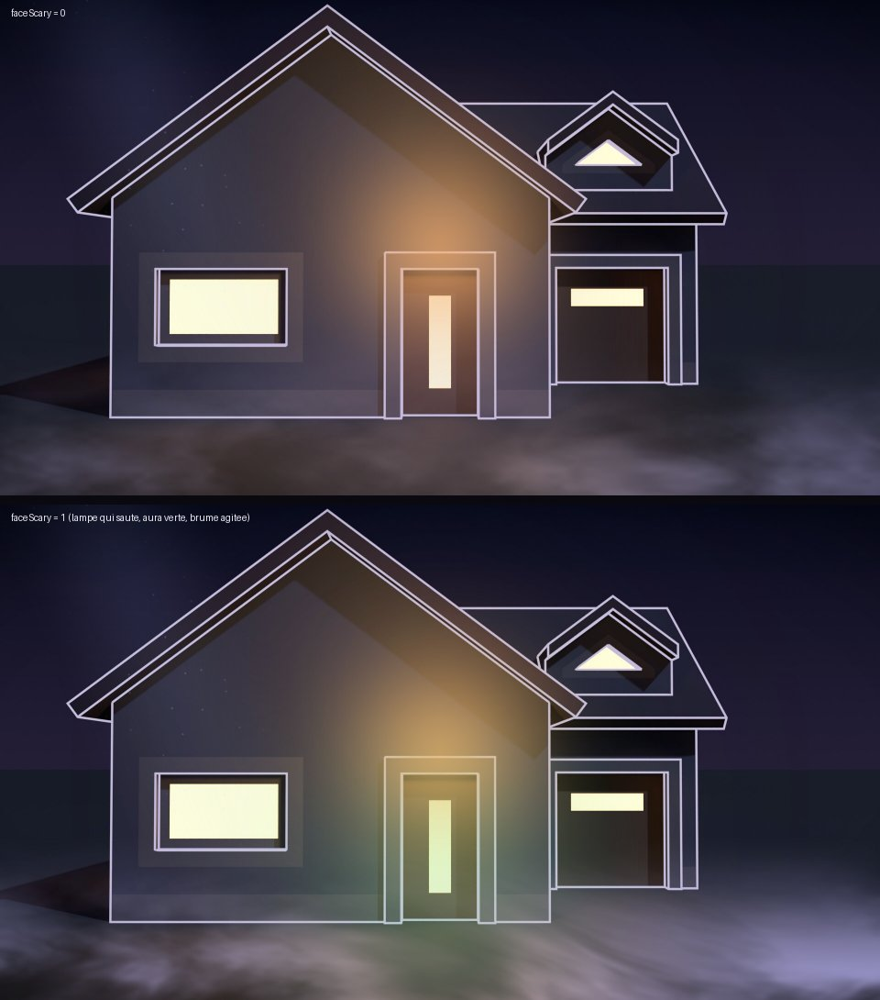

# Phase 6 : NuitFX (GPU Canvas)



Un shader WGSL et un script Luau qui ajoutent l'atmosphère de nuit, **pilotée par le visage** :

| Couche | Effet | Réagit à |
|---|---|---|
| Derrière (`layer = 0`) | halo chaud de la lampe au-dessus de la porte | `doorIndex` (allumée sur les porches, éteinte dans la rue) |
| | la lampe grésille puis **saute** | `faceScary` : plus tu fais peur, plus elle coupe |
| | rayon de lune et poussières qui flottent | le temps |
| | aura autour du drap, lavande → **vert spectral** | `faceScary`, `faceHeadX/Y` (elle suit le drap) |
| Devant (`layer = 1`) | brume au sol qui dérive et **s'écarte autour du drap** | `faceHeadX/Y` |
| | la brume s'agite | `faceScary` |
| | vignettage léger | — |
| Révélation (`horror` 0 → 1) | toutes les lumières s'éteignent, la lampe vire au rouge et meurt | `horror` |
| | une flaque de sang s'étale sous le drap, du sang coule du haut de l'écran | `horror` |
| | vignettage rouge qui bat comme un cœur (le même rythme que le son) | `horror` |

## Fichiers

- `NuitFX.wgsl` : validé avec naga et compilé sans erreur vers GLSL ES 300 (WebGL2), Metal, HLSL et SPIR-V.
- `NuitFX.luau` : le script Node. Deux lignes marquées « VÉRIFIER » utilisent des champs que la doc
  publique ne montre pas (`GPUBuffer.new`, `GPUBindGroup.new`) : l'éditeur les valide.

## Repères mesurés sur les rendus (1920 × 1080)

| Porche | Porte (x) | Seuil (y) | Haut de la porte (y) |
|---|---|---|---|
| 1 mamie | 877 → 1043 | 905 | 588 |
| 2 enfant | 877 → 1043 | 905 | 588 |
| 3 voisin | 877 → 1043 | 903 | 582 |
| 4 chez moi | 880 → 1048 | 960 | 637 |

## Prompt pour Claude Code (MCP Rive)

```
Phase 6 : GPU Canvas. Lis shaders/README.md, shaders/NuitFX.wgsl et shaders/NuitFX.luau.

1. Crée un script de type WGSL Shader nommé exactement NuitFX, colle le contenu de NuitFX.wgsl,
   compile, lis la console.
2. Crée un script Node nommé NuitFX_Script avec le contenu de NuitFX.luau. Corrige les deux lignes
   « VÉRIFIER » (GPUBuffer.new et GPUBindGroup.new) selon les types réels de l'éditeur. Ne change pas
   l'ordre ni la taille du buffer d'uniformes (48 octets, 12 floats, voir la struct Uniforms).
3. Place deux instances dans l'artboard Main, à l'origine de l'artboard, couvrant 1920 × 1080 :
   - NuitFX_Derriere, layer = 0, juste au-dessus de Decor (sous Habitants et Drap)
   - NuitFX_Devant, layer = 1, tout en haut (au-dessus de Drap)
4. Ajoute au View Model Costume un nombre `horror` (défaut 0). Lie les entrées des deux instances :
   scary ← faceScary, headX ← faceHeadX, headY ← faceHeadY, door ← doorIndex, horror ← horror.
   Dans l'état Revelation, anime `horror` de 0 à 1 en ~4 s (il redescend à 0 dans Enfiler).
   Vérifie que doorIndex vaut 1, 2, 3, 4 à l'entrée de Porte1, Porte2, Porte3, Fin et 0 dans Attente,
   Enfiler et Carte. Ajoute-le dans la State Machine si ce n'est pas le cas.
5. Règle ghostX / ghostY sur le centre de repos du drap, en UV (x / 1920, y / 1080).
6. Lance le mode Play. Si la brume apparaît en haut, mets flipY = 1 sur les deux instances.
   Si le halo n'est pas au-dessus de la porte, dis-le-moi avec la position observée.
7. Paramètres d'export : vérifie que les cibles de shader incluent GLSL ES 300 (WebGL2, utilisé par la
   page web) et WGSL. Sans GLSL ES 300, le shader ne se charge pas dans le navigateur.
8. Résume. J'exporte depuis l'application de bureau vers assets/rive/haunt.riv et je teste.
```

## Test dans la page

La page active déjà le GPU Canvas (`enableGPUCanvas`). `?gpu=0` le coupe pour comparer : le jeu doit
rester identique, sans l'atmosphère. Si le script échoue, il écrit « NuitFX désactivé : … » dans la
console de l'éditeur et ne dessine rien.
